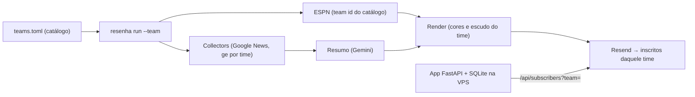

# Resenha — Plano do Projeto

> "Resenha" é **nome provisório** (pacote Python `resenha`). Trocar o nome é um `sed` enquanto o
> projeto é pequeno.

Hub de newsletters de futebol brasileiro, feito por diversão: a prioridade é criatividade e
torcida engajada, não negócio. Base técnica: a Urubu News (`~/flamengo-news`), que já resolve
coleta, resumo por IA, estatísticas da ESPN, envio pela Resend e inscrição com confirmação.

## 1. O que o hub tem

| Peça | Ideia |
|---|---|
| Newsletter por time | o torcedor escolhe um ou mais times; cada time tem a sua edição (pré-jogo, pós-jogo, notícias), como a Urubu News |
| Pedido de time | quem não acha o seu time pede; o time "nasce" quando junta pedidos e alguém configura as fontes |
| Edição geral | futebol brasileiro como um todo, com recorte por série (A, B, C, D) e, depois, por região |
| Ranking de torcidas | página pública "qual torcida mais assina o hub", por time e por série |
| Palpites / cartola simples | palpite de placar com um clique no pré-jogo, pontos apurados pela ESPN, ranking por torcida e geral |
| Joguinhos | "7 a 0": jogos rápidos tipo adivinhe o placar histórico, adivinhe o jogador, quiz da rodada |
| Fóruns | um por time e um geral |

## 2. Ordem das fatias

Cada fatia é um PR que funciona sozinho. A ordem segue o que destrava o resto:

1. **Newsletter de qualquer time** a partir de um catálogo de times (`teams.toml`). Sem isso nada existe.
2. **Inscrição com escolha de times** (um e-mail, várias assinaturas) e envio por time.
3. **Pedido de time novo** e **ranking de torcidas** (os dois vivem dos mesmos dados de inscrição).
4. **Edição geral** por série.
5. **Palpites** (cartola simples) com ranking.
6. **Joguinhos "7 a 0"**.
7. **Fóruns** — por último porque exigem login, moderação e anti-spam; é a peça mais cara de manter.

## 3. Arquitetura

Mesma forma da Urubu News, com o time virando parâmetro:

- **Catálogo de times** em `src/resenha/teams.toml`: `slug`, nome, apelido da torcida, ESPN id,
  slug do ge, termos de busca do Google News, cores, competições. Time novo = uma entrada nova.
- **Agenda por time**: a lógica de edições guiada por jogos (`flanews.schedule`) roda por time; o
  `due` devolve a lista de (time, edição) vencidas.
- **Web**: um app só (inscrição, ranking, palpites, pedidos), SQLite em volume Docker, atrás do
  Caddy na VPS (`infra`), como a Urubu News.

## 4. Stack

Igual à Urubu News: Python 3.12 + `uv`, `httpx`, `feedparser`, `selectolax`, `trafilatura`,
Gemini (`google-genai`), ESPN (API pública), Jinja2 + `premailer`, Resend, FastAPI + SQLite,
`typer`, `pytest` + `respx`, `ruff`.

## 5. Riscos

- **Cota do LLM**: o Gemini Flash gratuito dá ~20 chamadas/dia por modelo e uma edição gasta 4.
  Com mais de ~4 times por dia estoura. Saídas: só gerar edição de time com inscrito ativo,
  compartilhar a coleta entre times, e/ou plano pago (centavos por edição). Decidir na fatia 2,
  quando houver mais de um time com inscrito — se mudar de fornecedor, registrar ADR.
- **ESPN não documentada**: se mudar, a seção de estatísticas some (comportamento já herdado).
- **Fontes por time**: o ge tem página por clube; times de Série C/D têm pouca cobertura, então a
  edição desses times pode ser curta. Aceitável.

## 6. Decisões

| Data | Decisão | Motivo |
|---|---|---|
| 2026-11-10 | Repositório novo, começando por uma **cópia** do código da Urubu News generalizada por time (sem pacote compartilhado) | a Urubu News segue estável e com identidade própria; um pacote comum só vale a pena se os dois continuarem evoluindo juntos |
| 2026-11-10 | Times num catálogo `teams.toml` versionado, não no banco | time novo exige configurar e verificar fontes à mão; o pedido de time só conta votos |
| 2026-11-10 | Fóruns por último | login, moderação e spam custam mais que todo o resto junto |
